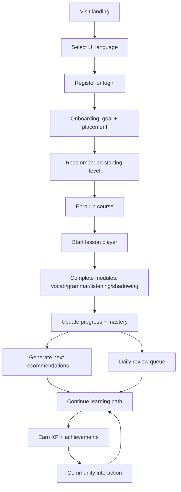

## 1. Product Overview
An online, multi-language education platform for immersive language learning (English, Japanese, Korean, plus other mainstream languages).
It combines leveled courses, interactive practice, personalized recommendations, and community incentives to drive long-term retention.

## 2. Core Features

### 2.1 User Roles
| Role | Registration Method | Core Permissions |
|------|---------------------|------------------|
| Learner | Email / OAuth (optional) | Enroll in courses, complete lessons, track progress, join community, earn achievements |
| Instructor (optional, phase 2) | Admin-invited | Create/curate courses, manage lesson content, review feedback |
| Moderator (optional, phase 2) | Admin-assigned | Manage reports, moderate posts/comments |
| Admin | Internal | User/course management, content moderation tools, analytics, configuration |

### 2.2 Feature Modules
1. **Landing / Marketing**: product value, supported languages, pricing (optional), CTA to sign up.
2. **Auth**: registration, login, password reset, email verification (optional).
3. **Onboarding & Placement**: goal selection, daily time budget, level placement quiz, target language choice.
4. **Course Catalog**: leveled courses (A1–C2 or equivalent), filters by language/level/topic, course details.
5. **Learning Player**: lesson units + modules (vocabulary, grammar, listening, shadowing), spaced repetition reviews.
6. **Progress & Insights**: streaks, proficiency by skill, time spent, mastery curves, goals.
7. **Personalized Path**: recommended next lessons, review queue, weak-skill targeting, adaptive difficulty.
8. **Community**: posts, comments, Q&A, study groups, challenge boards.
9. **Achievements & Incentives**: badges, points/XP, levels, leaderboards, seasonal challenges.
10. **Admin Console (MVP-light)**: manage courses/lessons/exercises, moderate content, view metrics.

### 2.3 Page Details
| Page Name | Module Name | Feature description |
|-----------|-------------|---------------------|
| Landing | Language picker | Switch UI language (English/Japanese/Korean/others), persists in profile and device |
| Auth | Register/Login | Email + password, optional OAuth; anti-bruteforce and rate limiting |
| Onboarding | Placement quiz | Short adaptive quiz to estimate level; lets user confirm/edit result |
| Catalog | Course list | Filter by language, level, topic; course card shows completion % if enrolled |
| Course | Curriculum | Units/lessons list, prerequisites, estimated time, skill focus breakdown |
| Player | Lesson timeline | Step-based flow mixing module types; resume where left off |
| Player | Vocabulary | Flashcards, typing, multiple choice; spaced repetition scheduling |
| Player | Grammar | Fill-in-the-blank, sentence ordering, error explanation with examples |
| Player | Listening | Audio + comprehension questions; variable speed; replay segments |
| Player | Shadowing | Record user voice, compare to reference, scoring feedback (MVP: waveform + self-review; later: ASR-based scoring) |
| Review | Daily review queue | SRS items due today, mix of vocab/grammar/listening snippets |
| Progress | Dashboard | Streak, XP, weekly minutes, skill radar, mastery per unit |
| Path | Recommendations | Next lesson suggestions + “why” explanation; quick-start daily plan |
| Community | Feed | Post creation, reactions, comments, report content, tag by language/level |
| Incentives | Achievements | Badge gallery, leaderboard, challenge details, reward history |
| Admin | Content tools | CRUD for courses/lessons/exercises, translation strings, moderation queue |

## 3. Core Process
Main learner flow:
1. User registers/logs in and selects UI + target language.
2. User completes onboarding and receives a starting level.
3. User enrolls in a leveled course and starts a lesson.
4. Lesson is delivered as a sequence of interactive modules.
5. Attempts and scores are tracked to update mastery and recommendations.
6. User completes daily review and earns XP/achievements; engages in community.

## 4. User Interface Design

### 4.1 Design Style
- Primary colors: deep neutral base (ink/graphite) with one vivid accent per target language (e.g., blue for English, vermilion for Japanese, emerald for Korean)
- Typography: one distinctive display font for headings + clean body font with strong CJK coverage
- Layout: desktop-first, “learning studio” feel; left nav for course/path, main panel for content, right rail for tips/progress (collapsible)
- Buttons: slightly rounded (8–12px), high-contrast, strong hover states; clear primary/secondary hierarchy
- Icon style: consistent line icons; use subtle animated feedback for completion and streaks
- Motion: step transitions in lesson player, staggered reveal for exercises, progress bar micro-animations

### 4.2 Page Design Overview
| Page Name | Module Name | UI Elements |
|-----------|-------------|-------------|
| Player | Module renderer | Large prompt area, response input, hints drawer, inline feedback, “next” CTA, progress timeline |
| Progress | Dashboard | Streak card, weekly heatmap, skill radar, mastery list, “focus areas” panel |
| Path | Recommendations | Daily plan card, lesson suggestions list with “why this” chips, difficulty selector |
| Community | Feed | Composer, post cards, reactions, comment thread, report button, language/level tags |
| Incentives | Achievements | Badge grid, leaderboard table, challenge banner, reward modal |

### 4.3 Responsiveness
- Desktop-first with adaptive layout for tablet and mobile
- Mobile learning: bottom navigation, reduced right-rail, larger touch targets, quick resume of last lesson
- Offline-friendly caching (phase 2): allow continuing last downloaded lesson, sync later

## 5. Non-Functional Requirements
- Internationalization: UI strings and content localization; per-user UI language and per-course target language
- Accessibility: keyboard navigation for exercises, captions/transcripts for audio, color contrast compliance
- Privacy: minimize voice data retention; consent + deletion controls for recordings
- Performance: lesson player loads under 2 seconds on median mobile; audio prefetch for next step
- Anti-cheat (leaderboard): basic anomaly detection (phase 2)

## 6. MVP Scope Boundary
- In scope: leveled course delivery, 4 core module types, progress tracking, auth, simple recommendations, community + achievements (basic)
- Out of scope (phase 2): instructor marketplace, advanced ASR scoring, live classes, paid subscriptions, offline mode, deep analytics
