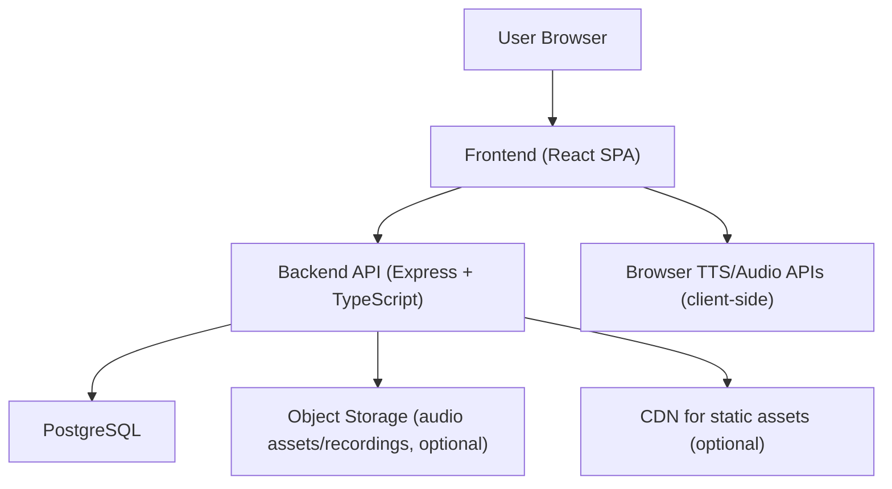
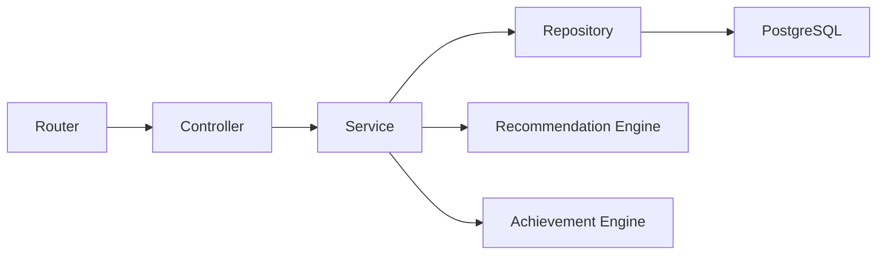
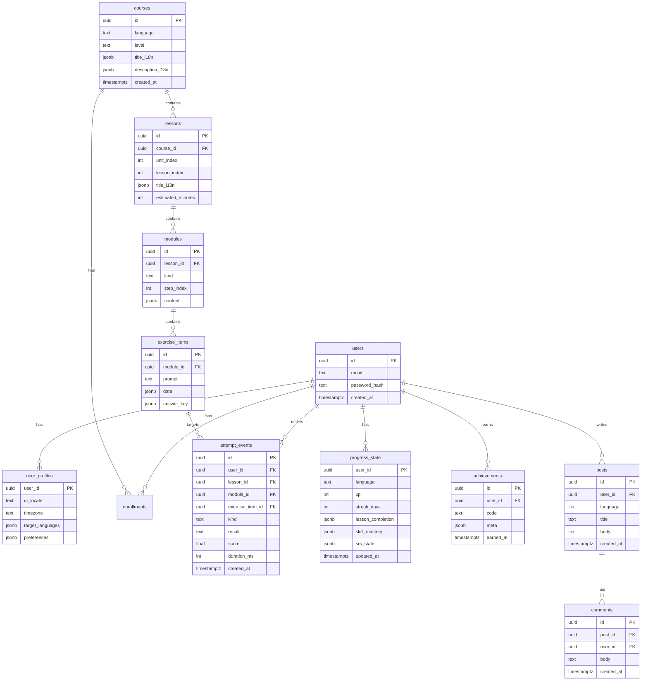

## 1. Architecture Design



## 2. Technology Description
- Frontend: React@18 + TypeScript + react-router-dom + tailwindcss@3 + zustand
- Initialization Tool: vite-init (react-express-ts template)
- Backend: Express@4 (TypeScript, ESM), REST APIs
- Database: PostgreSQL (MVP) with migrations
- Auth: session token via httpOnly cookies or JWT in httpOnly cookies (MVP); password hashing with bcrypt/argon2
- i18n: UI string bundles (JSON) + ICU message formatting (library selected during implementation based on repo dependencies)
- Audio: HTML5 audio for listening; MediaRecorder API for shadowing recordings (MVP: store and replay)

## 3. Route Definitions
| Route | Purpose |
|-------|---------|
| / | Landing + language selection |
| /login | Login |
| /register | Registration |
| /onboarding | Goal + placement |
| /catalog | Course catalog |
| /courses/:courseId | Course overview + curriculum |
| /learn/:lessonId | Lesson player |
| /review | Daily review queue |
| /progress | Progress dashboard |
| /path | Personalized recommendations |
| /community | Community feed |
| /achievements | Achievements + leaderboard |
| /admin | Admin console (role-gated) |

## 4. API Definitions

### 4.1 Auth
```ts
export type RegisterRequest = {
  email: string
  password: string
  uiLocale: string
}

export type LoginRequest = {
  email: string
  password: string
}

export type AuthUser = {
  id: string
  email: string
  uiLocale: string
  targetLanguages: string[]
}
```

Endpoints:
- POST /api/auth/register
- POST /api/auth/login
- POST /api/auth/logout
- GET /api/auth/me

### 4.2 Courses & Lessons
```ts
export type Course = {
  id: string
  language: string
  level: string
  title: string
  description: string
}

export type LessonSummary = {
  id: string
  courseId: string
  unitIndex: number
  lessonIndex: number
  title: string
  estimatedMinutes: number
}
```

Endpoints:
- GET /api/courses?language=&level=
- GET /api/courses/:courseId
- GET /api/courses/:courseId/lessons
- GET /api/lessons/:lessonId

### 4.3 Learning Attempts & Progress
```ts
export type AttemptEvent = {
  id: string
  userId: string
  lessonId: string
  moduleId: string
  itemId: string
  kind: "vocab" | "grammar" | "listening" | "shadowing"
  result: "correct" | "incorrect" | "skipped"
  score?: number
  durationMs?: number
  createdAt: string
}

export type ProgressSnapshot = {
  userId: string
  language: string
  xp: number
  streakDays: number
  lessonCompletion: Array<{ lessonId: string; completedAt: string }>
  skillMastery: Array<{ skill: "vocab" | "grammar" | "listening" | "speaking"; value: number }>
}
```

Endpoints:
- POST /api/attempts (batch supported)
- GET /api/progress/me?language=
- POST /api/lessons/:lessonId/complete

### 4.4 Recommendations
```ts
export type Recommendation = {
  lessonId: string
  reason: string
  priority: number
}
```

Endpoints:
- GET /api/recommendations/me?language=

MVP logic:
- Rule-based ranking using: last activity, incomplete prerequisites, review due items, weak-skill weighting, spaced repetition due dates.

### 4.5 Community & Achievements
Endpoints:
- GET/POST /api/community/posts
- GET/POST /api/community/posts/:postId/comments
- POST /api/community/posts/:postId/reactions
- GET /api/achievements/me
- GET /api/leaderboard?range=weekly

## 5. Server Architecture Diagram



## 6. Data Model

### 6.1 Data Model Definition


### 6.2 Data Definition Language
```sql
CREATE TABLE users (
  id uuid PRIMARY KEY,
  email text NOT NULL UNIQUE,
  password_hash text NOT NULL,
  created_at timestamptz NOT NULL DEFAULT now()
);

CREATE TABLE user_profiles (
  user_id uuid PRIMARY KEY REFERENCES users(id) ON DELETE CASCADE,
  ui_locale text NOT NULL,
  timezone text,
  target_languages jsonb NOT NULL DEFAULT '[]'::jsonb,
  preferences jsonb NOT NULL DEFAULT '{}'::jsonb
);

CREATE TABLE courses (
  id uuid PRIMARY KEY,
  language text NOT NULL,
  level text NOT NULL,
  title_i18n jsonb NOT NULL DEFAULT '{}'::jsonb,
  description_i18n jsonb NOT NULL DEFAULT '{}'::jsonb,
  created_at timestamptz NOT NULL DEFAULT now()
);

CREATE INDEX courses_language_level_idx ON courses(language, level);

CREATE TABLE lessons (
  id uuid PRIMARY KEY,
  course_id uuid NOT NULL REFERENCES courses(id) ON DELETE CASCADE,
  unit_index int NOT NULL,
  lesson_index int NOT NULL,
  title_i18n jsonb NOT NULL DEFAULT '{}'::jsonb,
  estimated_minutes int NOT NULL DEFAULT 10
);

CREATE UNIQUE INDEX lessons_course_unit_lesson_uq ON lessons(course_id, unit_index, lesson_index);

CREATE TABLE modules (
  id uuid PRIMARY KEY,
  lesson_id uuid NOT NULL REFERENCES lessons(id) ON DELETE CASCADE,
  kind text NOT NULL,
  step_index int NOT NULL,
  content jsonb NOT NULL DEFAULT '{}'::jsonb
);

CREATE UNIQUE INDEX modules_lesson_step_uq ON modules(lesson_id, step_index);

CREATE TABLE exercise_items (
  id uuid PRIMARY KEY,
  module_id uuid NOT NULL REFERENCES modules(id) ON DELETE CASCADE,
  prompt text NOT NULL,
  data jsonb NOT NULL DEFAULT '{}'::jsonb,
  answer_key jsonb NOT NULL DEFAULT '{}'::jsonb
);

CREATE TABLE attempt_events (
  id uuid PRIMARY KEY,
  user_id uuid NOT NULL REFERENCES users(id) ON DELETE CASCADE,
  lesson_id uuid NOT NULL REFERENCES lessons(id) ON DELETE CASCADE,
  module_id uuid NOT NULL REFERENCES modules(id) ON DELETE CASCADE,
  exercise_item_id uuid REFERENCES exercise_items(id) ON DELETE SET NULL,
  kind text NOT NULL,
  result text NOT NULL,
  score double precision,
  duration_ms int,
  created_at timestamptz NOT NULL DEFAULT now()
);

CREATE INDEX attempt_events_user_created_idx ON attempt_events(user_id, created_at DESC);

CREATE TABLE progress_state (
  user_id uuid NOT NULL REFERENCES users(id) ON DELETE CASCADE,
  language text NOT NULL,
  xp int NOT NULL DEFAULT 0,
  streak_days int NOT NULL DEFAULT 0,
  lesson_completion jsonb NOT NULL DEFAULT '[]'::jsonb,
  skill_mastery jsonb NOT NULL DEFAULT '[]'::jsonb,
  srs_state jsonb NOT NULL DEFAULT '{}'::jsonb,
  updated_at timestamptz NOT NULL DEFAULT now(),
  PRIMARY KEY (user_id, language)
);

CREATE TABLE achievements (
  id uuid PRIMARY KEY,
  user_id uuid NOT NULL REFERENCES users(id) ON DELETE CASCADE,
  code text NOT NULL,
  meta jsonb NOT NULL DEFAULT '{}'::jsonb,
  earned_at timestamptz NOT NULL DEFAULT now()
);

CREATE INDEX achievements_user_earned_idx ON achievements(user_id, earned_at DESC);

CREATE TABLE posts (
  id uuid PRIMARY KEY,
  user_id uuid NOT NULL REFERENCES users(id) ON DELETE CASCADE,
  language text NOT NULL,
  title text NOT NULL,
  body text NOT NULL,
  created_at timestamptz NOT NULL DEFAULT now()
);

CREATE INDEX posts_language_created_idx ON posts(language, created_at DESC);

CREATE TABLE comments (
  id uuid PRIMARY KEY,
  post_id uuid NOT NULL REFERENCES posts(id) ON DELETE CASCADE,
  user_id uuid NOT NULL REFERENCES users(id) ON DELETE CASCADE,
  body text NOT NULL,
  created_at timestamptz NOT NULL DEFAULT now()
);

CREATE INDEX comments_post_created_idx ON comments(post_id, created_at ASC);
```

## 7. Security & Privacy Notes (MVP)
- Store auth tokens in httpOnly cookies; protect with CSRF token if using cookies across domains.
- Hash passwords with a modern algorithm (argon2 preferred).
- Rate limit login and registration endpoints; lockout rules for repeated failures.
- Voice recordings: user-controlled retention; default short retention; signed URLs for access.
